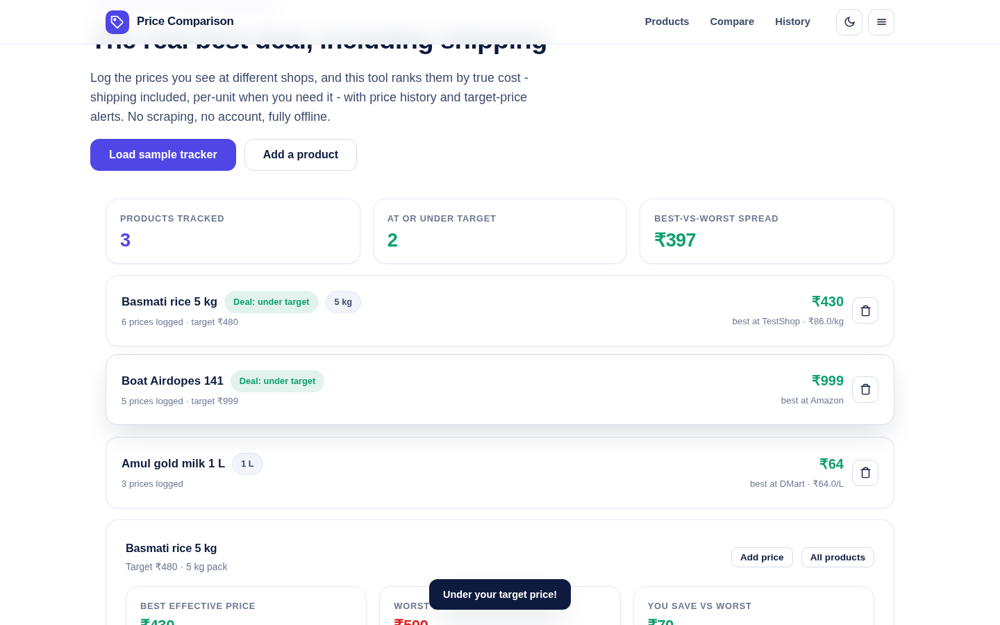

# Price Comparison

Track the prices you see at different shops and find the **real** best deal - shipping included, per-unit when it matters - with price history charts and target-price deal alerts. Free, offline-first, no account; everything is stored on your device.

**Live:** https://akash991833.github.io/price-comparison-app/



## Features

- **Products with targets and units**: target price triggers a "Deal" badge, unit size unlocks per-kg/L/pc pricing.
- **Effective-price ranking**: every entry is compared as price + shipping - the shop that looks cheapest often is not.
- **Best / worst / savings stats** per product and across the whole tracker.
- **Price history chart** per product: best-of-day and average lines plus your target line.
- **Fully local**: localStorage persistence, JSON export/import backup, one-click clear.
- **Sample tracker** to try every feature instantly.
- **PWA**: installable, works offline, dark + light themes, mobile + desktop.

## Honest limits

- Compares the prices **you enter** - it deliberately does not scrape stores (breaks their terms and breaks often).
- Data lives in this browser's localStorage; export a JSON backup before switching devices or clearing site data.

## Tech

Vanilla JS + Chart.js (vendored). No build step, no tracking.

## Run locally

```bash
python3 -m http.server 8080
```

## Tests

`tests/run.mjs` (Puppeteer): sample load, best-deal detection, per-unit math, add-price flow, target alert, history chart, persistence across reload - desktop/mobile x light/dark, fails on console errors.
